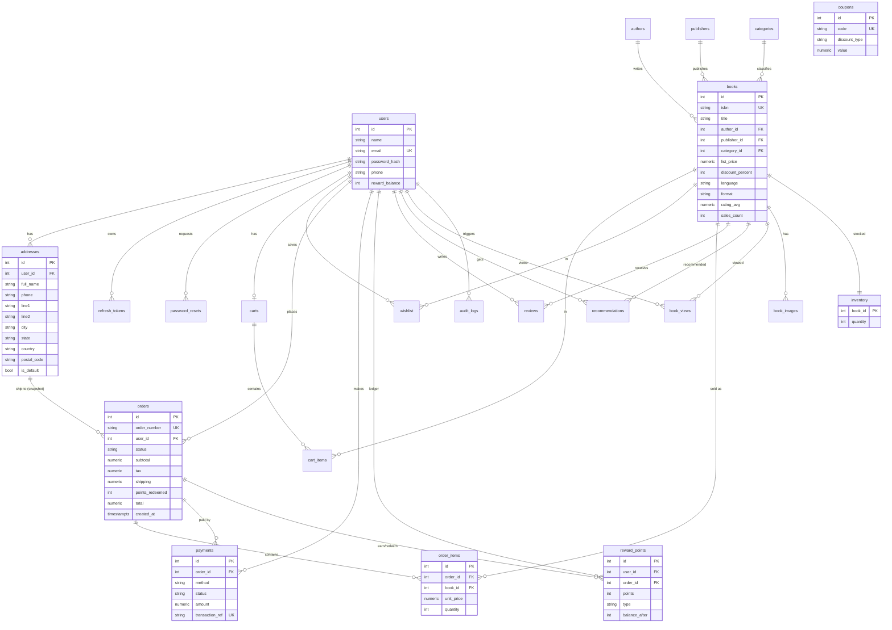

# Entity Relationship Diagram

Source of truth: [`database/schema.sql`](../database/schema.sql).

## Constraints highlights

| Area | Constraint |
|------|-----------|
| Users | unique `lower(email)`, `reward_balance >= 0` |
| Books | `list_price > 0`, `discount_percent 0..90`, `format IN (Paperback, Hardcover, eBook)`, unique ISBN |
| Inventory | `quantity >= 0` (prevents overselling at DB level) |
| Cart | one cart per user, unique `(cart_id, book_id)`, quantity 1..10 |
| Orders | status CHECK list, totals `>= 0`, address snapshotted into `ship_*` columns |
| Payments | method/status CHECK, unique `transaction_ref` |
| Reviews | rating 1..5, one review per user per book |
| Rewards | append-only ledger with `balance_after >= 0` |

## Key indexes

`ux_users_email`, `ix_books_category/author/publisher/price/rating/sales/published`, full-text GIN index on title+description, `ix_orders_user_created`, `ix_order_items_book`, `ix_reward_points_user`, `ix_recommendations_user`, `ix_audit_logs_entity`.
